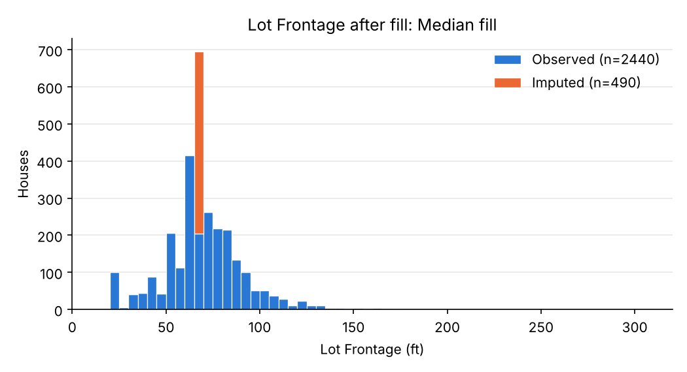
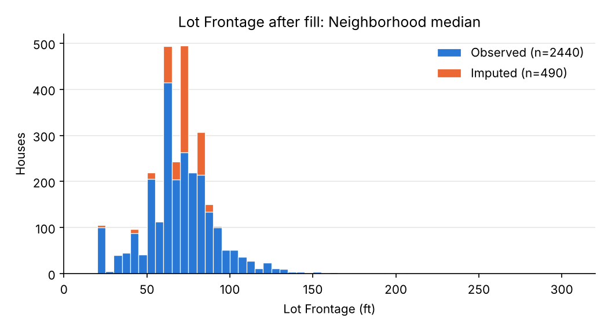
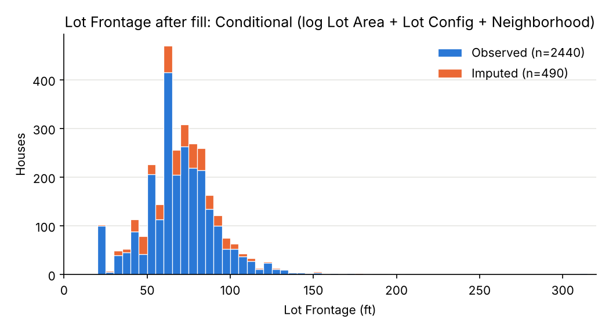

# HW 5 report: Ames Housing data audit

<!-- Generated by src/report.py from reports/report_template.md. Edit the template, not this file. -->

`make all`: download -> clean -> validate -> missingness -> impute -> evaluate -> this report. Every table is written by `src/`.

## 1 Provenance

URL, date, citation and terms are in `README.md`. On arrival: **2,930 rows, 82 columns**. `src/download.py` checks the shape and never overwrites the raw copy.

## 2 Validation: failures on the raw file

Rules (each cites its source in the code): exact 82-column set with dtype family (44 text, 38 numeric); 37 range
rules; dictionary codes for all 43 categorical columns and MS SubClass; 13 cross-column rules. Raw fails 11, cleaned passes all.

| check | rule / column | finding | n | what we did |
| --- | --- | --- | --- | --- |
| range | Garage Yr Blt | outside [1864, 2010], values [2207.0] | 1 | Set to NaN (2207 is impossible; 2007 is a guess, not a fix). |
| allowed | MS Zoning | codes not in dictionary {'C (all)': 25, 'I (all)': 2, 'A (agr)': 2} | 29 | Mapped to dictionary codes C, I, A (explicit map in clean.py, logged). |
| allowed | Neighborhood | codes not in dictionary {'NAmes': 443} | 443 | Mapped NAmes -> Names (dictionary code for North Ames), logged. |
| allowed | Bldg Type | codes not in dictionary {'Duplex': 109, 'Twnhs': 101, '2fmCon': 62} | 272 | Mapped Duplex->Duplx, Twnhs->TwnhsI, 2fmCon->2FmCon, logged. |
| allowed | Exterior 2nd | codes not in dictionary {'CmentBd': 126, 'Wd Shng': 81, 'Brk Cmn': 22} | 229 | Mapped CmentBd->CemntBd, Wd Shng->WdShing, Brk Cmn->BrkComm, logged. |
| allowed | Sale Type | codes not in dictionary {'WD ': 2536} | 2536 | Stripped the trailing space ('WD ' -> 'WD'). |
| cross | Year Remod/Add >= Year Built | violated | 1 | Year Remod/Add set to NaN (cannot tell which year is wrong). |
| cross | Year Remod/Add <= Yr Sold (+1 for Partial sales) | violated | 1 | Year Remod/Add set to NaN. |
| cross | Garage Yr Blt <= Yr Sold (+1 for Partial sales) | violated | 1 | Same row as the 2207 range failure: NaN. |
| cross | Mas Vnr Type is none <=> Mas Vnr Area == 0 | violated | 10 | Both columns set to NaN in these rows. |
| cross | Garage Type not none => Garage Finish/Qual/Cond not none | violated | 1 | Garage exists, so 'No Garage' is wrong: Qual/Cond set to NaN (unknown). |

Code mismatches are mapped by an explicit, logged table (`CODE_FIXES`), never silently; `NAmes` is likely a dictionary
typo, but the dictionary stays the reference. `Partial` sales may show a year one after the sale (dictionary: "not
completed when last assessed"). The dictionary also names 10 columns differently from the file (`Exterior 1` vs
`Exterior 1st`); the schema follows the file.

## 3 Sentinels and structural absence

Default load vs `keep_default_na=False, na_values=[""]`. Every column where the default load creates NaN,
and which raw token it came from:

| column | default_NaN | as 'NA' | as 'None' | as empty | dictionary_none_code | dictionary_meaning |
| --- | --- | --- | --- | --- | --- | --- |
| Lot Frontage | 490 | 0 | 0 | 490 | - | no none-code: empty = unknown |
| Alley | 2732 | 2732 | 0 | 0 | NA | No alley access |
| Mas Vnr Type | 1775 | 0 | 1752 | 23 | None | None (no masonry veneer) |
| Mas Vnr Area | 23 | 0 | 0 | 23 | - | no none-code: empty = unknown |
| Bsmt Qual | 80 | 79 | 0 | 1 | NA | No Basement |
| Bsmt Cond | 80 | 79 | 0 | 1 | NA | No Basement |
| Bsmt Exposure | 83 | 79 | 0 | 4 | NA | No Basement |
| BsmtFin Type 1 | 80 | 79 | 0 | 1 | NA | No Basement |
| BsmtFin SF 1 | 1 | 0 | 0 | 1 | - | no none-code: empty = unknown |
| BsmtFin Type 2 | 81 | 79 | 0 | 2 | NA | No Basement |
| BsmtFin SF 2 | 1 | 0 | 0 | 1 | - | no none-code: empty = unknown |
| Bsmt Unf SF | 1 | 0 | 0 | 1 | - | no none-code: empty = unknown |
| Total Bsmt SF | 1 | 0 | 0 | 1 | - | no none-code: empty = unknown |
| Electrical | 1 | 0 | 0 | 1 | - | no none-code: empty = unknown |
| Bsmt Full Bath | 2 | 0 | 0 | 2 | - | no none-code: empty = unknown |
| Bsmt Half Bath | 2 | 0 | 0 | 2 | - | no none-code: empty = unknown |
| Fireplace Qu | 1422 | 1422 | 0 | 0 | NA | No Fireplace |
| Garage Type | 157 | 157 | 0 | 0 | NA | No Garage |
| Garage Yr Blt | 159 | 0 | 0 | 159 | - | no none-code: empty = unknown |
| Garage Finish | 159 | 157 | 0 | 2 | NA | No Garage |
| Garage Cars | 1 | 0 | 0 | 1 | - | no none-code: empty = unknown |
| Garage Area | 1 | 0 | 0 | 1 | - | no none-code: empty = unknown |
| Garage Qual | 159 | 158 | 0 | 1 | NA | No Garage |
| Garage Cond | 159 | 158 | 0 | 1 | NA | No Garage |
| Pool QC | 2917 | 2917 | 0 | 0 | NA | No Pool |
| Fence | 2358 | 2358 | 0 | 0 | NA | No Fence |
| Misc Feature | 2824 | 2824 | 0 | 0 | NA | None |

- **"NA" occurs in 14 columns; in every one the dictionary defines it as "none"** (no alley, basement, fireplace,
  garage, pool, fence, misc feature). Unknown is always an **empty field**.
- **Other strings turned into NaN:** `None`, only in `Mas Vnr Type` (1,752 rows), where the dictionary
  defines it as no veneer: a real category the default load erases. The default load also strips PID's leading zero.
- **Decoding.** Only empty fields become NaN; "none" codes become the explicit category `Absent` (which no CSV reader
  drops). Logged exceptions: a "none" that contradicts another column becomes NaN (a 360 sq ft garage rated
  "No Garage"); structurally fixed blanks become 0 (basement baths with no basement). `Garage Yr Blt` NaN for the 157
  garage-less houses is structural and never imputed.

Numeric columns that use 0 for "none":

| column | zeros | none_column | argument |
| --- | --- | --- | --- |
| Mas Vnr Area | 1748 | Mas Vnr Type | True zero: no veneer has 0 sq ft. The 'none' itself is in Mas Vnr Type. |
| Total Bsmt SF | 79 | Bsmt Qual | True zero: 0 sq ft exactly when Bsmt Qual says No Basement (rule checked). |
| BsmtFin SF 1 | 930 | BsmtFin Type 1 | True zero: unfinished or absent basement has 0 finished sq ft. |
| BsmtFin SF 2 | 2578 | BsmtFin Type 2 | True zero, same as BsmtFin SF 1. |
| Bsmt Unf SF | 244 | Bsmt Qual | True zero: fully finished or absent basement. |
| Bsmt Full Bath | 1707 | Bsmt Qual | True zero count; for no-basement houses it is also structural. |
| Bsmt Half Bath | 2753 | Bsmt Qual | True zero count, as above. |
| 2nd Flr SF | 1678 | House Style | True zero: 1-story houses have no second floor. |
| Low Qual Fin SF | 2890 | - | True zero: no low-quality finished area. |
| Full Bath | 12 | - | True zero count (above grade only; such houses have basement baths). |
| Half Bath | 1843 | - | True zero count. |
| Bedroom AbvGr | 8 | - | True zero: the dictionary excludes basement bedrooms from this count. |
| Kitchen AbvGr | 3 | - | Plausible true zero (above grade only), but Kitchen Qual is still rated: flagged, kept. |
| Fireplaces | 1422 | Fireplace Qu | True zero: exactly when Fireplace Qu says No Fireplace (rule checked). |
| Garage Cars | 157 | Garage Type | True zero: no garage holds 0 cars (Garage Type = No Garage). |
| Garage Area | 157 | Garage Type | True zero: 0 sq ft exactly when there is no garage (rule checked). |
| Wood Deck SF | 1526 | - | True zero: no deck. No separate 'none' column exists. |
| Open Porch SF | 1300 | - | True zero: no porch of this type. |
| Enclosed Porch | 2471 | - | True zero: no porch of this type. |
| 3Ssn Porch | 2893 | - | True zero: no porch of this type. |
| Screen Porch | 2674 | - | True zero: no porch of this type. |
| Pool Area | 2917 | Pool QC | True zero: exactly when Pool QC says No Pool (rule checked). |
| Misc Val | 2827 | Misc Feature | Mostly structural (no feature). 3 rows have a feature with $0 value: kept as recorded. |

All are **true zeros, not sentinels**: an absent pool has 0 sq ft, and the structural column says "none" for exactly
those rows (cross-column rules). Year columns, where 0 would be a sentinel, use empty fields instead.

Every change made to the data:

| step | column | rows | what | why |
| --- | --- | --- | --- | --- |
| strip | Sale Type | 2536 | removed surrounding whitespace | dictionary code has no trailing space |
| code | MS Zoning | 25 | 'C (all)' -> 'C' | dictionary code for the same category |
| code | MS Zoning | 2 | 'I (all)' -> 'I' | dictionary code for the same category |
| code | MS Zoning | 2 | 'A (agr)' -> 'A' | dictionary code for the same category |
| code | Neighborhood | 443 | 'NAmes' -> 'Names' | dictionary code for the same category |
| code | Bldg Type | 109 | 'Duplex' -> 'Duplx' | dictionary code for the same category |
| code | Bldg Type | 101 | 'Twnhs' -> 'TwnhsI' | dictionary code for the same category |
| code | Bldg Type | 62 | '2fmCon' -> '2FmCon' | dictionary code for the same category |
| code | Exterior 2nd | 126 | 'CmentBd' -> 'CemntBd' | dictionary code for the same category |
| code | Exterior 2nd | 81 | 'Wd Shng' -> 'WdShing' | dictionary code for the same category |
| code | Exterior 2nd | 22 | 'Brk Cmn' -> 'BrkComm' | dictionary code for the same category |
| contradiction | Garage Qual | 1 | 'NA' (no garage) -> NaN | Garage Type says a garage exists: value unknown |
| contradiction | Garage Cond | 1 | 'NA' (no garage) -> NaN | Garage Type says a garage exists: value unknown |
| structural | Alley | 2732 | 'NA' -> 'Absent' | dictionary: No alley access |
| structural | Bsmt Qual | 79 | 'NA' -> 'Absent' | dictionary: No Basement |
| structural | Bsmt Cond | 79 | 'NA' -> 'Absent' | dictionary: No Basement |
| structural | Bsmt Exposure | 79 | 'NA' -> 'Absent' | dictionary: No Basement |
| structural | BsmtFin Type 1 | 79 | 'NA' -> 'Absent' | dictionary: No Basement |
| structural | BsmtFin Type 2 | 79 | 'NA' -> 'Absent' | dictionary: No Basement |
| structural | Fireplace Qu | 1422 | 'NA' -> 'Absent' | dictionary: No Fireplace |
| structural | Garage Type | 157 | 'NA' -> 'Absent' | dictionary: No Garage |
| structural | Garage Finish | 157 | 'NA' -> 'Absent' | dictionary: No Garage |
| structural | Garage Qual | 157 | 'NA' -> 'Absent' | dictionary: No Garage |
| structural | Garage Cond | 157 | 'NA' -> 'Absent' | dictionary: No Garage |
| structural | Pool QC | 2917 | 'NA' -> 'Absent' | dictionary: No Pool |
| structural | Fence | 2358 | 'NA' -> 'Absent' | dictionary: No Fence |
| structural | Misc Feature | 2824 | 'NA' -> 'Absent' | dictionary: None |
| structural | Mas Vnr Type | 1752 | 'None' -> 'Absent' | dictionary: None (no masonry veneer) |
| structural | Bsmt Full Bath | 1 | NaN -> 0 | Bsmt Qual = No Basement, so the count/area is 0 |
| structural | Bsmt Half Bath | 1 | NaN -> 0 | Bsmt Qual = No Basement, so the count/area is 0 |
| impossible | Garage Yr Blt | 1 | value after the study period -> NaN | range rule; 2207 is probably 2007 but that is a guess |
| contradiction | Year Remod/Add | 2 | -> NaN | before construction or after the sale |
| contradiction | Mas Vnr Type | 10 | -> NaN | type and area disagree; either could be the error |
| contradiction | Mas Vnr Area | 10 | -> NaN | type and area disagree; either could be the error |

Missing values after decoding (true unknowns vs structural):

| column | NaN | structural | true_unknown | share |
| --- | --- | --- | --- | --- |
| Lot Frontage | 490 | 0 | 490 | 0.1672 |
| Year Remod/Add | 2 | 0 | 2 | 0.0007 |
| Mas Vnr Type | 33 | 0 | 33 | 0.0113 |
| Mas Vnr Area | 33 | 0 | 33 | 0.0113 |
| Bsmt Qual | 1 | 0 | 1 | 0.0003 |
| Bsmt Cond | 1 | 0 | 1 | 0.0003 |
| Bsmt Exposure | 4 | 0 | 4 | 0.0014 |
| BsmtFin Type 1 | 1 | 0 | 1 | 0.0003 |
| BsmtFin SF 1 | 1 | 0 | 1 | 0.0003 |
| BsmtFin Type 2 | 2 | 0 | 2 | 0.0007 |
| BsmtFin SF 2 | 1 | 0 | 1 | 0.0003 |
| Bsmt Unf SF | 1 | 0 | 1 | 0.0003 |
| Total Bsmt SF | 1 | 0 | 1 | 0.0003 |
| Electrical | 1 | 0 | 1 | 0.0003 |
| Bsmt Full Bath | 1 | 0 | 1 | 0.0003 |
| Bsmt Half Bath | 1 | 0 | 1 | 0.0003 |
| Garage Yr Blt | 160 | 157 | 3 | 0.0546 |
| Garage Finish | 2 | 0 | 2 | 0.0007 |
| Garage Cars | 1 | 0 | 1 | 0.0003 |
| Garage Area | 1 | 0 | 1 | 0.0003 |
| Garage Qual | 2 | 0 | 2 | 0.0007 |
| Garage Cond | 2 | 0 | 2 | 0.0007 |

## 4 Keys and duplicates

| key | unique | duplicates | identifies |
| --- | --- | --- | --- |
| Order | True | 0 | a row of this file (observation number 1..2930) |
| PID | True | 0 | a parcel (a property), not a sale |
| PID + Yr Sold + Mo Sold | True | 0 | a sale: one parcel sold in one month |

| check | count |
| --- | --- |
| exact duplicate rows | 0 |
| duplicates ignoring Order | 0 |
| duplicates ignoring Order and PID | 0 |
| PIDs with a leading 0 (lost by the default load) | 2929 |
| PID length != 10 after default load (int) | 2929 |

`Order` identifies a row; `PID` a parcel, unique only because no parcel sold twice in 2006-2010. **Key: `Order`**,
with PID + Yr Sold + Mo Sold as the natural sale key (also unique). PID must be text: as an integer 2,929 PIDs lose
their leading 0. Neighborhood lookup (28 dictionary names), `pd.merge(..., validate="many_to_one")`:

| rows_before | rows_after | lookup_rows | unmatched | neighborhoods_in_data |
| --- | --- | --- | --- | --- |
| 2930 | 2930 | 28 | 0 | 28 |

Row count unchanged, no unmatched sales (with the raw `NAmes` code, 443 would be unmatched).

## 5 Missingness mechanism

| column | missing | share |
| --- | --- | --- |
| Lot Frontage | 490 | 0.1672 |
| Mas Vnr Area | 33 | 0.0113 |

**Lot Frontage.** Notebook §4.1 comparison (group means by "is missing"), then medians, standardized differences and tests:

| Lot Frontage missing | Lot Area | SalePrice | Year Built | Gr Liv Area |
| --- | --- | --- | --- | --- |
| False | 9710 | 180100 | 1971 | 1489 |
| True | 12331 | 184263 | 1976 | 1553 |

| observed column | median, missing | median, present | mean, missing | mean, present | std. mean diff | Mann-Whitney p |
| --- | --- | --- | --- | --- | --- | --- |
| Lot Area | 1.04e+04 | 9.25e+03 | 1.23e+04 | 9.71e+03 | 0.261 | 1.36e-12 |
| SalePrice | 1.73e+05 | 1.58e+05 | 1.84e+05 | 1.8e+05 | 0.0577 | 5.23e-06 |
| Year Built | 1.98e+03 | 1.97e+03 | 1.98e+03 | 1.97e+03 | 0.183 | 0.317 |
| Gr Liv Area | 1.49e+03 | 1.43e+03 | 1.55e+03 | 1.49e+03 | 0.127 | 0.00485 |

| observed | chi2_p | overall_share | highest |
| --- | --- | --- | --- |
| Lot Config | 6.19e-35 | 0.167 | CulDSac 49% (n=180), FR3 29% (n=14), FR2 24% (n=85) |
| Neighborhood | 1.02e-40 | 0.167 | GrnHill 100% (n=2), Landmrk 100% (n=1), ClearCr 55% (n=44) |
| Bldg Type | 0.00646 | 0.167 | 1Fam 17% (n=2425), TwnhsE 17% (n=233), Duplx 16% (n=109) |

| Lot Config | n | missing | share_missing |
| --- | --- | --- | --- |
| CulDSac | 180 | 88 | 0.489 |
| FR3 | 14 | 4 | 0.286 |
| FR2 | 85 | 20 | 0.235 |
| Corner | 511 | 104 | 0.204 |
| Inside | 2140 | 274 | 0.128 |

*MAR; MCAR rejected.* Under MCAR the share missing would be similar everywhere. It is 49% on cul-de-sacs vs 13% on
inside lots, 0-55% across neighborhoods (chi-square p < 1e-30), and missing lots are larger (median 10,398 vs 9,249
sq ft); Year Built does not differ. *The data cannot tell us* whether, within a lot type and neighborhood, missing
frontages are shorter or longer than recorded ones (MNAR): the values needed to test it are the missing ones.

**Mas Vnr Area** (33 missing: 23 empty fields + 10 type/area contradictions):

| Mas Vnr Area missing | Lot Area | SalePrice | Year Built | Gr Liv Area |
| --- | --- | --- | --- | --- |
| False | 10142 | 180291 | 1971 | 1498 |
| True | 10696 | 225121 | 1998 | 1637 |

| observed column | median, missing | median, present | mean, missing | mean, present | std. mean diff | Mann-Whitney p |
| --- | --- | --- | --- | --- | --- | --- |
| Lot Area | 9.96e+03 | 9.43e+03 | 1.07e+04 | 1.01e+04 | 0.0831 | 0.352 |
| SalePrice | 2.06e+05 | 1.6e+05 | 2.25e+05 | 1.8e+05 | 0.562 | 0.000144 |
| Year Built | 2e+03 | 1.97e+03 | 2e+03 | 1.97e+03 | 1.1 | 7.73e-09 |
| Gr Liv Area | 1.56e+03 | 1.44e+03 | 1.64e+03 | 1.5e+03 | 0.302 | 0.0276 |

| observed | chi2_p | overall_share | highest |
| --- | --- | --- | --- |
| Lot Config | 0.952 | 0.0113 | CulDSac 2% (n=180), FR2 1% (n=85), Corner 1% (n=511) |
| Neighborhood | 1.5e-05 | 0.0113 | Somerst 6% (n=182), Gilbert 4% (n=165), BrDale 3% (n=30) |
| Bldg Type | 0.725 | 0.0113 | TwnhsE 1% (n=233), 1Fam 1% (n=2425), Duplx 1% (n=109) |

Year Built of the 33 houses with missing veneer: min 1956, median 2005, max 2008; 79% built in 2000 or later (all houses: 27%).

*MAR; MCAR rejected.* Missing rows concentrate in new construction (Year Built std. difference 1.1, p < 0.001) and
newer subdivisions (neighborhood p < 0.001), not by Lot Config or Bldg Type (p = 0.95, 0.72): likely records of new
houses not yet complete. *The data cannot tell us,* with 33 rows, whether the missing veneers are mostly "none" or
brick, or whether the 10 contradiction rows share that process.

**If Lot Frontage were MNAR:** the assessor leaves frontage blank when it is hard to measure or barely exists: curved
cul-de-sac frontages, flag lots reaching the street by a narrow strip, lots on a private drive. The blank then depends
on the frontage itself. Tellingly, the file records no frontage of 0, although such lots must exist.

## 6 Imputation strategy and defense (at most 150 words)

Costs (std and correlation "before" use the 2,440 observed values only):

| strategy | mean before | mean after | std before | std after | std change % | corr Lot Area before | corr Lot Area after | corr log-log before | corr log-log after |
| --- | --- | --- | --- | --- | --- | --- | --- | --- | --- |
| median | 69.225 | 69.020 | 23.365 | 21.326 | -8.726 | 0.491 | 0.363 | 0.767 | 0.688 |
| nbhd_median | 69.225 | 69.463 | 23.365 | 21.718 | -7.048 | 0.491 | 0.389 | 0.767 | 0.714 |
| conditional | 69.225 | 69.725 | 23.365 | 23.530 | 0.707 | 0.491 | 0.540 | 0.767 | 0.768 |

As notebook §5 warns, regression fills sit on the line with no noise, so they can overstate a correlation; that is
the 0.49 -> 0.54 rise in raw correlation below (`IterativeImputer(sample_posterior=True)` would add the noise back).

Supporting check (hide 20% of known frontages, fill them, measure the error). This is not the defense:

| strategy | hidden | RMSE_ft | median_abs_err_ft |
| --- | --- | --- | --- |
| median | 488 | 21.02 | 12.00 |
| nbhd_median | 488 | 17.80 | 8.00 |
| conditional | 488 | 17.27 | 7.04 |

**Choice: the conditional fill** (regression of log Lot Frontage on log Lot Area, Lot Config and Neighborhood).
Part 5 found the values missing at random given observed columns: missing far more often on cul-de-sacs (49%)
than inside lots (13%), unevenly across neighborhoods (0-55%), and on larger lots. Under MAR, a fill is unbiased
only if it conditions on the variables that drive the missingness. The median fill ignores all three: it gives
large cul-de-sac lots a typical inside-lot frontage, piles 490 values onto one number and shrinks the
spread by 9%. The neighborhood median conditions on just one driver. The conditional fill uses exactly the
observed drivers, so it keeps the spread (+0.7%) and the log-log relationship with Lot Area (0.768 vs 0.767).
Costs we accept: fills sit on the regression line, so the raw correlation with Lot Area rises slightly
(0.49 to 0.54); and no fill corrects MNAR.

## 7 Leakage-safe evaluation

Given model, 12 features (README), RMSE in log units (0.155 is about a 16% typical error).

| variant | fill | RMSE_log | fold_sd |
| --- | --- | --- | --- |
| A | SalePrice-quintile median, full table (6.1) | 0.15527 | 0.02388 |
| B | conditional imputer fitted on full table before CV (6.2) | 0.15525 | 0.02344 |
| C | conditional imputer inside Pipeline (6.3) | 0.15524 | 0.02343 |
| ref | Lot Frontage dropped (not a variant; for scale) | 0.15534 | 0.02228 |

- Rows used: 2928 (dropped Order [1342, 2237]: unknown values in other features).
- A - C = +0.00003; B - C = +0.000005 (+0.003% of C).
- Lot Frontage missing in 490 rows (16.7%).
- B vs C fills on test-fold rows: mean |difference| 0.75 ft, max 8.86 ft (fills themselves average 72.2 ft).

Per-fold scores:

| variant | RMSE_log | fold1 | fold2 | fold3 | fold4 | fold5 |
| --- | --- | --- | --- | --- | --- | --- |
| A | 0.15527 | 0.13104 | 0.13324 | 0.16114 | 0.18884 | 0.16208 |
| B | 0.15525 | 0.13131 | 0.13332 | 0.16153 | 0.18771 | 0.16235 |
| C | 0.15524 | 0.13133 | 0.13332 | 0.16152 | 0.18770 | 0.16233 |
| ref | 0.15534 | 0.13236 | 0.13395 | 0.16201 | 0.18524 | 0.16314 |

Diagnostic (not a variant): Lot Frontage as the only feature, and correlation of the fills with log price on the 490 missing rows:

| variant | RMSE_log_LotFrontage_only | corr_fill_vs_logprice_on_missing_rows |
| --- | --- | --- |
| A | 0.3795 | 0.8914 |
| B | 0.3842 | 0.2345 |
| C | 0.3843 | 0.2345 |

- **Correct: C**, the imputer refitted in each training fold. **A leaks the target**: fills are the median of the
  house's SalePrice quintile, so they encode its price (correlation 0.89 vs 0.23); alone, A "wins" (0.380 vs 0.384).
  **B leaks test-fold features**: imputer fitted on all rows before CV; no price leaks, but it is not out-of-sample.
- **Cannot price an unsold house: A**, since choosing the quintile needs the sale price.
- **B vs C: about 5e-6 (0.003%).** The imputer uses no y, so B only sees 20% more feature rows: fills move 0.75 ft on
  average, on 16.7% of rows. And Lot Frontage barely matters given Lot Area, Gr Liv Area and Overall Qual (dropping it
  costs 0.0001). That dilution also hides A's leak (A - C = +0.00003): a small gap does not mean no leakage.

## 8 What this data cannot tell you

**Changed:** whitespace and 10 codes mapped to the dictionary; "none" codes in 15 columns recoded to `Absent`; contradictions and
impossible values set to NaN, not guessed (garage year 2207, 2 remodel years, 10 veneer rows, 1 garage's Qual/Cond);
2 structural zeros filled. Nothing is imputed in the cleaned file; the raw file is untouched.

**Cannot be resolved:** MAR vs MNAR for Lot Frontage and veneer; which field is wrong in contradiction rows; real
remodel dates for old houses (339 of 632 pre-1950 houses show exactly 1950, an apparent assessor floor); whether mapped
codes (`Twnhs` = `TwnhsI`) truly match; repeat sales (each parcel appears once), other cities, years or unsold houses;
whether the 5 houses over 4,000 sq ft (3 Partial sales) are errors. We kept them.
