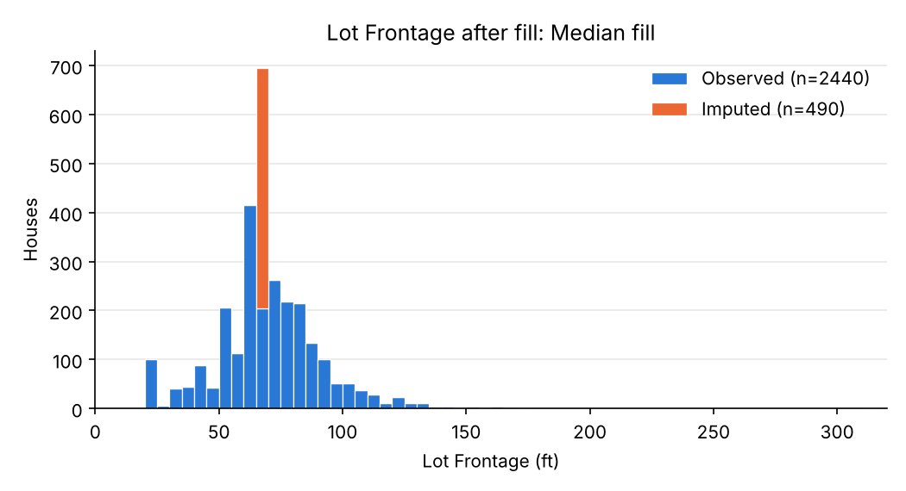
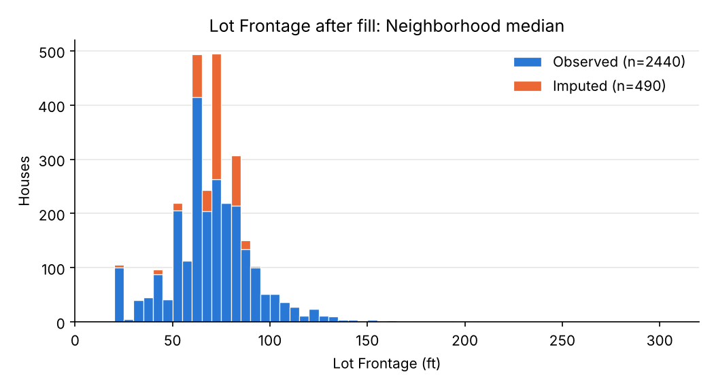
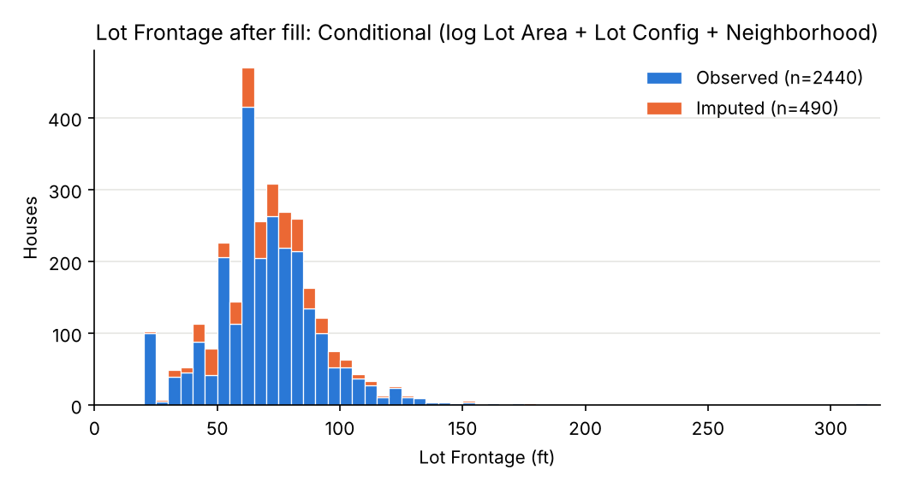

# HW 5 report: Ames Housing data audit

<!-- Generated by src/report.py from reports/report_template.md. Edit the template, not this file. -->

`make all`: download -> clean -> validate -> missingness -> impute -> evaluate -> this report. Every table is written by `src/`.

## 1 Provenance

URL, date, citation and terms are in `README.md`. On arrival: **2,930 rows, 82 columns**. `src/download.py` checks the shape and never overwrites the raw copy.

## 2 Validation: failures on the raw file

Rules (each cites its source in the code): exact 82-column set with dtype family (44 text, 38 numeric); 37 range
rules; dictionary codes for all 43 categorical columns and MS SubClass; 13 cross-column rules. Raw fails 11, cleaned passes all.

{{validation_table}}

Code mismatches are mapped by an explicit, logged table (`CODE_FIXES`), never silently; `NAmes` is likely a dictionary
typo, but the dictionary stays the reference. `Partial` sales may show a year one after the sale (dictionary: "not
completed when last assessed"). The dictionary also names 10 columns differently from the file (`Exterior 1` vs
`Exterior 1st`); the schema follows the file.

## 3 Sentinels and structural absence

Default load vs `keep_default_na=False, na_values=[""]`. Every column where the default load creates NaN,
and which raw token it came from:

{{sentinels}}

- **"NA" occurs in 14 columns; in every one the dictionary defines it as "none"** (no alley, basement, fireplace,
  garage, pool, fence, misc feature). Unknown is always an **empty field**.
- **Other strings turned into NaN:** {{other_na_tokens}}, only in `Mas Vnr Type` (1,752 rows), where the dictionary
  defines it as no veneer: a real category the default load erases. The default load also strips PID's leading zero.
- **Decoding.** Only empty fields become NaN; "none" codes become the explicit category `Absent` (which no CSV reader
  drops). Logged exceptions: a "none" that contradicts another column becomes NaN (a 360 sq ft garage rated
  "No Garage"); structurally fixed blanks become 0 (basement baths with no basement). `Garage Yr Blt` NaN for the 157
  garage-less houses is structural and never imputed.

Numeric columns that use 0 for "none":

{{zeros}}

All are **true zeros, not sentinels**: an absent pool has 0 sq ft, and the structural column says "none" for exactly
those rows (cross-column rules). Year columns, where 0 would be a sentinel, use empty fields instead.

Every change made to the data:

{{changes}}

Missing values after decoding (true unknowns vs structural):

{{missing_after}}

## 4 Keys and duplicates

{{keys}}

{{duplicates}}

`Order` identifies a row; `PID` a parcel, unique only because no parcel sold twice in 2006-2010. **Key: `Order`**,
with PID + Yr Sold + Mo Sold as the natural sale key (also unique). PID must be text: as an integer 2,929 PIDs lose
their leading 0. Neighborhood lookup (28 dictionary names), `pd.merge(..., validate="many_to_one")`:

{{join}}

Row count unchanged, no unmatched sales (with the raw `NAmes` code, 443 would be unmatched).

## 5 Missingness mechanism

{{mech_share}}

**Lot Frontage.** Notebook §4.1 comparison (group means by "is missing"), then medians, standardized differences and tests:

{{mech_lot_frontage}}

{{mech_lotconfig}}

*MAR; MCAR rejected.* Under MCAR the share missing would be similar everywhere. It is 49% on cul-de-sacs vs 13% on
inside lots, 0-55% across neighborhoods (chi-square p < 1e-30), and missing lots are larger (median 10,398 vs 9,249
sq ft); Year Built does not differ. *The data cannot tell us* whether, within a lot type and neighborhood, missing
frontages are shorter or longer than recorded ones (MNAR): the values needed to test it are the missing ones.

**Mas Vnr Area** (33 missing: 23 empty fields + 10 type/area contradictions):

{{mech_mas_vnr_area}}

{{mech_masvnr_years}}

*MAR; MCAR rejected.* Missing rows concentrate in new construction (Year Built std. difference 1.1, p < 0.001) and
newer subdivisions (neighborhood p < 0.001), not by Lot Config or Bldg Type (p = 0.95, 0.72): likely records of new
houses not yet complete. *The data cannot tell us,* with 33 rows, whether the missing veneers are mostly "none" or
brick, or whether the 10 contradiction rows share that process.

**If Lot Frontage were MNAR:** the assessor leaves frontage blank when it is hard to measure or barely exists: curved
cul-de-sac frontages, flag lots reaching the street by a narrow strip, lots on a private drive. The blank then depends
on the frontage itself. Tellingly, the file records no frontage of 0, although such lots must exist.

## 6 Imputation strategy and defense (at most 150 words)

Costs (std and correlation "before" use the 2,440 observed values only):

{{impute_costs}}

As notebook §5 warns, regression fills sit on the line with no noise, so they can overstate a correlation; that is
the 0.49 -> 0.54 rise in raw correlation below (`IterativeImputer(sample_posterior=True)` would add the noise back).

Supporting check (hide 20% of known frontages, fill them, measure the error). This is not the defense:

{{impute_masked}}

**Choice: the conditional fill** (regression of log Lot Frontage on log Lot Area, Lot Config and Neighborhood).
Part 5 found the values missing at random given observed columns: missing far more often on cul-de-sacs (49%)
than inside lots (13%), unevenly across neighborhoods (0-55%), and on larger lots. Under MAR, a fill is unbiased
only if it conditions on the variables that drive the missingness. The median fill ignores all three: it gives
large cul-de-sac lots a typical inside-lot frontage, piles 490 values onto one number and shrinks the
spread by 9%. The neighborhood median conditions on just one driver. The conditional fill uses exactly the
observed drivers, so it keeps the spread (+0.7%) and the log-log relationship with Lot Area (0.768 vs 0.767).
Costs we accept: fills sit on the regression line, so the raw correlation with Lot Area rises slightly
(0.49 to 0.54); and no fill corrects MNAR.

## 7 Leakage-safe evaluation

Given model, 12 features (README), RMSE in log units (0.155 is about a 16% typical error).

{{eval_scores}}

{{eval_facts}}

Per-fold scores:

{{eval_folds}}

Diagnostic (not a variant): Lot Frontage as the only feature, and correlation of the fills with log price on the 490 missing rows:

{{eval_diag}}

- **Correct: C**, the imputer refitted in each training fold. **A leaks the target**: fills are the median of the
  house's SalePrice quintile, so they encode its price (correlation 0.89 vs 0.23); alone, A "wins" (0.380 vs 0.384).
  **B leaks test-fold features**: imputer fitted on all rows before CV; no price leaks, but it is not out-of-sample.
- **Cannot price an unsold house: A**, since choosing the quintile needs the sale price.
- **B vs C: about 5e-6 (0.003%).** The imputer uses no y, so B only sees 20% more feature rows: fills move 0.75 ft on
  average, on 16.7% of rows. And Lot Frontage barely matters given Lot Area, Gr Liv Area and Overall Qual (dropping it
  costs 0.0001). That dilution also hides A's leak (A - C = +0.00003): a small gap does not mean no leakage.

## 8 What this data cannot tell you

**Changed:** whitespace and 10 codes mapped to the dictionary; "none" codes in 15 columns recoded to `Absent`; contradictions and
impossible values set to NaN, not guessed (garage year 2207, 2 remodel years, 10 veneer rows, 1 garage's Qual/Cond);
2 structural zeros filled. Nothing is imputed in the cleaned file; the raw file is untouched.

**Cannot be resolved:** MAR vs MNAR for Lot Frontage and veneer; which field is wrong in contradiction rows; real
remodel dates for old houses (339 of 632 pre-1950 houses show exactly 1950, an apparent assessor floor); whether mapped
codes (`Twnhs` = `TwnhsI`) truly match; repeat sales (each parcel appears once), other cities, years or unsold houses;
whether the 5 houses over 4,000 sq ft (3 Partial sales) are errors. We kept them.
